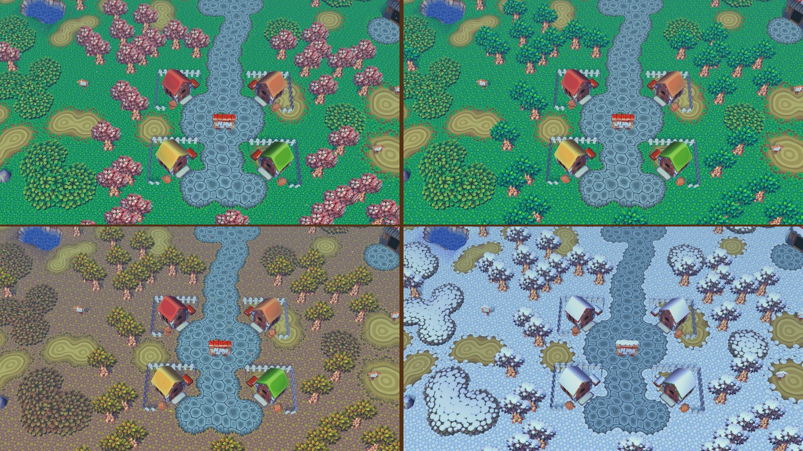
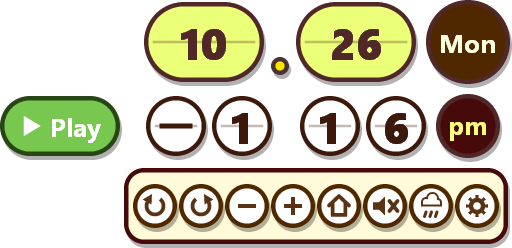

# ACGC Desktop

**Animal Crossing (GameCube) as your live desktop wallpaper.**



Your own town, from your own save, runs behind your desktop icons in real time. A slow, zoomed-out camera drifts between acres and stops to watch your villagers. The seasons, the time of day and the weather follow your PC's clock, and the game's own clock sits in the corner of the desktop. When you want to play, click **Play** (or press <kbd>Ctrl</kbd>+<kbd>Alt</kbd>+<kbd>P</kbd>) and the wallpaper becomes the game. Press <kbd>Ctrl</kbd>+<kbd>Alt</kbd>+<kbd>W</kbd> to send it back to the desktop.

This is a fork of [ACGC-PC-Port](https://github.com/flyngmt/ACGC-PC-Port) by FlyingMeta. That port runs the [ac-decomp](https://github.com/ACreTeam/ac-decomp) decompilation natively on Windows, and this fork adds the wallpaper mode on top. Without `--wallpaper`, the program behaves like the regular PC port.

> This repository contains no game assets. You need your own copy of the game:
> **Animal Crossing (USA), GAFE01 Rev 0**, as an ISO, GCM or CISO disc image.

## Features

- **Live wallpaper.** The game renders behind your desktop icons and doesn't take input while idle. Clicks on the desktop go to the desktop as usual.
- **Your town, never your save.** The wallpaper shows your town from your save, but never writes to your save file.
- **A wandering camera.** A slow camera drifts around your town from above, from acre to acre, and stops by to watch your villagers.
- **Hourly music.** With the volume turned up, the wallpaper plays the town's music for the current hour, including the town tune on the hour.
- **Real time.** The wallpaper uses your PC's date and time and your town's real weather and season.
  - **Kept in sync:** the clock resyncs every minute and after the PC wakes from sleep.
  - **Custom clock:** set any date and time in the settings. A custom clock keeps running from the time you set.
- **Desktop clock widget**, drawn in the style of the in-game clock:
  - **Clock:** date, weekday, time and am/pm, with a **Play** button beside the time.
  - **Drawer:** a thin bar under the time opens to show the camera controls (rotate, zoom, reset), a music volume slider, a weather on/off button and settings. Fully zoomed in matches the normal gameplay camera.
  - **Hide the clock** to keep only Play, a settings button and the drawer.
- **Weather that fills the screen.** Rain, snow, cherry blossoms and falling leaves cover the whole view.
- **Tray icon** with Play, Return to wallpaper and Quit.

## Quick start

1. **Download** the latest `ACGC-Desktop` zip from the [Releases](../../releases) page and extract it anywhere, for example `Documents\ACGC-Desktop`.
2. **Add your game.** Put your disc image (`.iso`, `.gcm` or `.ciso`) in the `rom` folder.
   - **Your save:** to use the town you already have, put your Dolphin save's `.gci` files in the `save` folder. No save yet? Press **Play**, start a new game and save. From then on, the wallpaper shows your town.
3. **Start it.** Double-click **`Start Wallpaper.bat`**.
   - **Startup:** the town takes about 20 seconds to appear behind your desktop icons, and the clock widget appears in the bottom-right corner.
   - **SmartScreen:** Windows may warn you about an unrecognised app the first time. Click *More info*, then *Run anyway*.

To start it with Windows, press <kbd>Win</kbd>+<kbd>R</kbd>, type `shell:startup`, and put a shortcut to `Start Wallpaper.bat` in the folder that opens.

To run it as the regular PC port instead (a normal game window), start `AnimalCrossing.exe` directly.

## Using it

| | Wallpaper (idle) | Playing |
|---|---|---|
| Switch | **Play** button, <kbd>Ctrl</kbd>+<kbd>Alt</kbd>+<kbd>P</kbd>, or the tray menu | <kbd>Ctrl</kbd>+<kbd>Alt</kbd>+<kbd>W</kbd> or the tray menu |
| Window | Behind the desktop icons, full screen | Borderless fullscreen with focus |
| Input | None (the desktop keeps working) | Keyboard and controller, as in the PC port |
| Audio | The widget's music volume (starts at 0, silent) | Normal |

From the wallpaper, **Play** opens the regular title screen; choose *Start Game* to load your save as usual. In wallpaper mode, the title screen's and pause menu's *Quit Game* become **Return to Desktop**: they send the game back to the wallpaper instead of closing it. Double-clicking the tray icon also switches modes. To close the program, use *Quit* in the tray menu.

> [!IMPORTANT]
> **Save in the game before you press <kbd>Ctrl</kbd>+<kbd>Alt</kbd>+<kbd>W</kbd>.** Returning to the wallpaper doesn't save for you yet. If you quit without saving, Mr. Resetti will have something to say next time.

### The widget



The panel in the bottom-right corner of your desktop shows the town's clock. **▶ Play**, to the left of the time, switches to playing.

The thin brown bar under the time is a drawer. Hover over it and it thickens; click it to slide it open, which pushes the clock up and shows the camera buttons. Click the drawer's background to close it again. Each button shows a tooltip when you hover over it.

| Button | Action |
|---|---|
| ↺ ↻ | Rotate the camera (up to ±35°). Hold to keep turning. |
| − + | Zoom out / in. Fully zoomed in matches the regular gameplay camera. Hold to keep zooming. |
| ⌂ | Reset the camera. |
| 🔈 | Music volume while the wallpaper is idle. Click it to open a slider above it, then click or drag along the slider. The mouse wheel works too. It starts at 0 (silent), is remembered between runs, and the slider tucks away when you click elsewhere or move off the widget. |
| ☁ | Show or hide weather particles (rain, snow, cherry blossoms, falling leaves) on the wallpaper. Remembered between runs; doesn't affect normal play. |
| ⚙ | Settings. |

With **Hide the clock** turned on in the settings, the widget shrinks to **▶ Play** and a ⚙ settings badge. The drawer under them holds the other buttons in two rows.

### Settings

The ⚙ button opens the settings dialog:

- **Town clock:** use this PC's date and time, or a custom date and time. A custom clock keeps ticking from the time you set. Changing the clock reloads the idle scene, so the season and lighting update.
- **Clock size:** the size of the widget: Small (80%), Normal (100%), Large (120%) or Extra large (150%).
- **Hide the clock:** show only Play, settings and the drawer.
- **Clock position:** any corner, the middle of any edge, or **Free place**. Choosing Free place (or **Move...** next to it) lifts the widget above your windows with a dashed outline. Drag it wherever you like, then click **Accept** to keep it there, or **Cancel** to put it back. Along the top edge, the drawer opens downward instead of pushing the clock up.
- **Camera speed:** how fast the camera wanders: Very slow, Slow (default), Normal or Fast.

The settings are saved in `wallpaper.ini` next to the executable:

```ini
# Town clock = this PC's clock + clock_offset_seconds (0 = the PC's date and time)
clock_offset_seconds = 0
# Size of the clock/controls widget (1.0 = normal)
widget_scale = 1.20
# top-left, top-center, top-right, left-center, right-center, bottom-left, bottom-center,
# bottom-right, or free (at widget_free_x/y pixels from the top-left of the work area)
widget_position = bottom-right
widget_free_x = 0
widget_free_y = 0
# 1 = hide the date and time
hide_clock = 0
# Camera/walker pace while idle (1.0 = original pace; Slow = 0.6)
camera_speed = 0.60
# Music and sound while idle, as % of the game's master volume (0 = silent)
music_volume = 0
# 1 = show rain, snow, cherry blossoms and falling leaves on the wallpaper
weather_particles = 1
```

### Command-line options

`Start Wallpaper.bat` runs `AnimalCrossing.exe --wallpaper`. You can add any of these options to it, or to a shortcut:

| Flag | Description |
|---|---|
| `--wallpaper` | Run as the desktop wallpaper |
| `--wallpaper-volume N` | Starting volume while idle, as 0–100% of the master volume (default 0, muted). Once the music button has been used, `wallpaper.ini` wins. |
| `--rain [light\|normal\|heavy]` | Force rain (handy for previewing the weather) |
| `--snow`, `--blossoms`, `--leaves` | Force snow, cherry blossoms or falling leaves |
| `--time H[:M[:S]]`, `--date M/D[/Y]` | Start the clock at this time/date (it keeps ticking) |
| `--verbose` | Diagnostic logging |
| `--timelapse` | Record a sped-up day of the wallpaper scene to `timelapse.mp4`, then exit (needs [ffmpeg](https://ffmpeg.org/)) |
| `--timelapse-speed X`, `--timelapse-start H`, `--timelapse-hours N` | Clock speed-up while recording (default 360: 6 game minutes per second), starting hour (default 3 AM) and length in game hours (default 24) |
| `--timelapse-out FILE`, `--ffmpeg PATH` | Output video, and the ffmpeg executable if it isn't on `PATH` |

### Timelapse videos

`--timelapse` turns the idle scene into a recorder. The town's clock runs fast while the camera slowly tours the village from acre to acre, visiting villagers along the way. The recording opens beside a villager at 3 AM. One frame per game minute goes to ffmpeg, giving a 1080p, 30 fps video where a full day takes 48 seconds. At the default speed (6 game minutes per real second), recording a day takes about 4 minutes.

```bash
AnimalCrossing.exe --timelapse --ffmpeg "C:\path\to\ffmpeg.exe"
```

Recording never touches your save, like the rest of idle mode.

All of the [PC port's options](docs/pc-port.md#command-line-options) work too.

## Building

You need [MSYS2](https://www.msys2.org/) and its **MINGW32** environment. The game must be built as 32-bit.

```bash
pacman -S --needed mingw-w64-i686-gcc mingw-w64-i686-cmake mingw-w64-i686-SDL2 mingw-w64-i686-ninja
```

From the **MSYS2 MINGW32** shell:

```bash
git clone <this repository> ACGC-Desktop
cd ACGC-Desktop/pc
mkdir -p build32 && cd build32
cmake .. -G Ninja
ninja
mkdir -p bin/rom bin/save
```

The program ends up in `pc/build32/bin/`. Put your disc image in `bin/rom/` and run `AnimalCrossing.exe --wallpaper` from there.

To make a release folder like the downloadable one, run `pc/package_release.ps1` from PowerShell after building. It copies the program, `SDL2.dll`, the shaders, `Start Wallpaper.bat`, empty `rom` and `save` folders and the docs into `release/ACGC-Desktop/`.

MSYS2 no longer ships `mingw-w64-i686-make`, so the upstream `build_pc.sh` (which uses `mingw32-make`) may not work. Ninja does the same job.

## Requirements

- Windows 10 or 11. The wallpaper uses Explorer's desktop windows, including the new layout in Windows 11 24H2.
- An OpenGL 3.3 GPU.
- *Animal Crossing* (USA, GAFE01 Rev 0) disc image.

## Known limitations

- **Returning to the wallpaper doesn't save the game** (see above).
- **Primary monitor only.**
- **The wallpaper always renders.** It runs at 60 fps and doesn't pause when a fullscreen app is in front. (But it uses 1/4 as much resources as Discord in the background!)
- **The camera is simple.** It wanders and visits villagers. It doesn't yet seek out events such as K.K. Slider, fireworks or the Bug-Off.
- **The camera occasionally gets stuck** behind a river or cliff. After a few seconds it moves on somewhere else.

## Documentation

- [docs/wallpaper.md](docs/wallpaper.md): how the wallpaper mode works, a file-by-file list of every change to the game code, troubleshooting.
- [docs/pc-port.md](docs/pc-port.md): the upstream PC port's README (controls, settings, texture packs, saves).
- [pc/DOCUMENTATION.md](pc/DOCUMENTATION.md): the PC port's developer documentation.
- [FAQ.md](FAQ.md): the upstream PC port FAQ.

## Credits

- [ACreTeam](https://github.com/ACreTeam) for the [ac-decomp](https://github.com/ACreTeam/ac-decomp) decompilation that all of this is built on.
- [FlyingMeta](https://github.com/flyngmt) for [ACGC-PC-Port](https://github.com/flyngmt/ACGC-PC-Port).
- Animal Crossing is © Nintendo. This project isn't affiliated with or endorsed by Nintendo.

## License

Same as the upstream port; see [LICENSE](LICENSE). The decompilation code is CC0, and the PC layer (`pc/` and the `#ifdef TARGET_PC` additions, which include this wallpaper mode) is MIT.

## AI notice

The wallpaper mode was written with the help of Claude (Anthropic), in the same spirit as the upstream port's AI notice.
